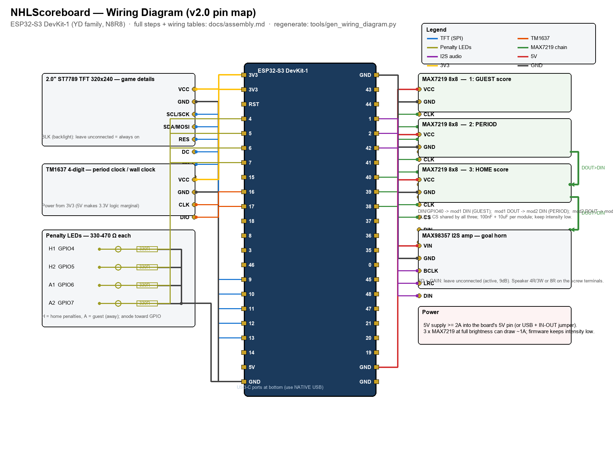

# NHLScoreboard — Assembly & Wiring Guide

Everything needed to wire the scoreboard end to end. The pin plan and its
rationale live in [`hardware.md`](hardware.md); this document is the
build-side companion: parts, wiring tables, the rendered diagram, assembly
order, and the first-boot checklist. Firmware **v3.58** supports both
board wiring revisions. The diagram below shows the original **board V0.1**;
board **V1.0** changes the TM1637 CLK and DIO connections as listed below,
and the firmware corrects its matrix and penalty LED mappings. Select the
board version in the setup portal and reboot after changing it.



*(Diagram shows board V0.1. It is regenerated by
`tools/gen_wiring_diagram.py` whenever pins change — edit the script, not the
PNG.)*

## Parts list

| Qty | Part | Role | Notes |
|---|---|---|---|
| 1 | ESP32-S3 DevKit-1 (N8R8) | controller | 8 MB flash, octal PSRAM; native USB-C port used for power/flash/serial |
| 1 | 2.0" ST7789V TFT, 240×320, SPI | game details screen | 7-pin module (VCC GND SCL SDA RES DC CS BLK) |
| 3 | MAX7219 8×8 LED matrix module | away score, home score, period | generic red 4-board strips split into single modules; daisy-chained |
| 1 | TM1637 4-digit 7-segment module | period clock / wall clock | 4 pins: VCC GND CLK DIO |
| 1 | MAX98357A I2S amp breakout | goal-horn audio | plus a 4 Ω/3 W (or 8 Ω) speaker |
| 4 | LED + 330–470 Ω resistor | penalty indicators | 2 home, 2 guest; 3 mm or 5 mm, any color |
| 2 | 470 kΩ resistor | battery-sense divider (V1.1 only) | 1/4 W any type; with the 100 nF below |
| 1 | 100 nF ceramic capacitor | divider filter (V1.1 only) | across the lower 470 kΩ; any voltage rating |
| — | hookup wire, headers, perfboard | assembly | 22–24 AWG for power runs |

Power: a **5 V ≥ 2 A** supply feeding the board's 5V pin (or a strong USB
supply with the board's `IN-OUT` jumper closed). Three MAX7219 modules at
full brightness alone can draw ~1 A; the firmware keeps intensity low, but
size for the worst case.

## Wiring tables

Physical positions refer to the header map in `hardware.md` (counting from
the end nearest the RST button / top of the board photo).

### TFT — game details (left header)

| TFT pin | Goes to | GPIO | Phys. pos |
|---|---|---|---|
| VCC | 3V3 | — | L1/L2 |
| GND | GND | — | L22 |
| SCL/SCK | TFT SCK | 8 | L12 |
| SDA/MOSI | TFT MOSI | 3 | L13 |
| RES | TFT RESET | 46 | L14 |
| DC | TFT DC | 9 | L15 |
| CS | TFT CS | 10 | L16 |
| BLK | *(leave unconnected — backlight always on)* | — | — |

### TM1637 — period clock / wall clock (left header)

| TM1637 pin | Goes to | Board V0.1 GPIO | Board V1.0 GPIO | Phys. pos |
|---|---|---|---|---|
| VCC | **3V3** (not 5 V — keeps logic levels matched) | — | — | L1/L2 |
| GND | GND | — | — | L22 |
| CLK | TM1637 CLK | 16 | 15 | L9 / L8 |
| DIO | TM1637 DIO | 17 | 16 | L10 / L9 |

### Penalty LEDs (left header)

GPIO → LED anode → resistor → GND, one per LED:

| LED | GPIO | Phys. pos | Resistor |
|---|---|---|---|
| Home penalty 1 | 4 | L4 | 330–470 Ω |
| Home penalty 2 | 5 | L5 | 330–470 Ω |
| Guest penalty 1 | 11 | L17 | 330–470 Ω |
| Guest penalty 2 | 12 | L18 | 330–470 Ω |

### MAX7219 chain — scores + period (right header)

| MAX7219 pin | Goes to | GPIO | Phys. pos |
|---|---|---|---|
| VCC (all 3) | 5V | — | L21 |
| GND (all 3) | GND | — | R1 |
| CLK (all 3, shared) | MAX7219 CLK | 39 | R9 |
| CS/LOAD (all 3, shared) | MAX7219 CS | 38 | R10 |
| DIN (**module 1 only**) | MAX7219 DIN | 40 | R8 |
| DOUT module 1 → | DIN module 2 | — | jumper |
| DOUT module 2 → | DIN module 3 | — | jumper |

Module order in the chain is **1 = guest score, 2 = period, 3 = home
score** (the shared-load shift order is handled in the driver). Add
100 nF + 10 µF decoupling per module.

### MAX98357A — goal horn (right header)

| Amp pin | Goes to | GPIO | Phys. pos |
|---|---|---|---|
| VIN | 5V | — | L21 |
| GND | GND | — | R1 |
| BCLK | I2S BCLK | 1 | R4 |
| LRC | I2S LRC/WS | 2 | R5 |
| DIN | I2S data | 42 | R6 |
| SD, GAIN | *(leave unconnected — active, 9 dB gain)* | — | — |

Speaker lands on the amp's screw terminals (4 Ω/3 W or 8 Ω).

### Battery sense divider — V1.1 boards (optional, left header)

Halves the LiPo voltage into the ADC range of GPIO 14 so the power gate
(`common/app/power_monitor`) can detect a low pack at boot and shut the
board down cleanly instead of brown-out cycling. Existing V0.1/V1.0 boards
skip this entirely.

```
   BAT+ (after switch) ───────┬──────────────────► to boost converter IN+
                               │                    (existing 5 V power path)
                            ┌──┴──┐
                            │ R1  │  470 kΩ
                            └──┬──┘
                               │
     ESP32 GPIO 14 ◄───────────┤      sense node = V(BAT+) / 2
     (left header pos 20)      │      (1.50–2.10 V over a 3.0–4.2 V pack)
                               │
                            ┌──┴──┐   ┌──────┐
                            │ R2  │   │  C1  │   C1 sits across R2
                            │470kΩ│   │100nF │
                            └──┬──┘   └──┬───┘
                               │         │
                               └────┬────┘
                                    │
     ESP32 GND ◄────────────────────┘
     (left header pos 22)
```

| From | Wire to | Phys. pos | Notes |
|---|---|---|---|
| GPIO 14 | R1 (470 kΩ), other leg → BAT+ | L20 | tap the **switched** battery side — the boost IN+ terminal is a convenient node |
| GPIO 14 | R2 (470 kΩ), other leg → GND | L20 | sense node lands on the GPIO leg of both parts |
| GPIO 14 | C1 (100 nF), other leg → GND | L20 | across R2; smooths boost-converter ripple for the ADC |
| GND | battery / boost ground | L22 | the divider must share the board's common ground |

Why it's wired this way:

- **Tap after the power switch** — the divider draws only ~4.5 µA
  (4.2 V / 940 kΩ) while running, and nothing at all when the switch is
  off, so it never drains a stored pack.
- **Sense node = half the pack** — 1.5–2.1 V sits comfortably inside the
  ADC's ~0–3.1 V window at 11 dB attenuation; firmware multiplies by 2
  (`BATTERY_SENSE_DIVIDER`).
- **GPIO 14, not 20/21** — the sense pin must be ADC-capable: GPIO 20 is
  native USB D− and GPIO 21 has no ADC channel on ESP32-S3. GPIO 14
  (ADC2_CH3, left header pos 20) is the ADC spare right beside 5V/GND
  (pos 21/22), keeping the divider wiring short.
- **After wiring**: select **Board V1.1 (battery sense)** in the setup
  portal and reboot — that's what enables the voltage check. Don't select
  V1.1 on a board without the divider; a floating ADC pin can read like a
  dead pack.

### Power/ground summary

| Rail | Sources on board | Consumers |
|---|---|---|
| 3V3 | L1, L2 | TFT VCC, TM1637 VCC |
| 5V | L21 | 3× MAX7219 VCC, MAX98357 VIN |
| GND | L22, R1, R21, R22 | **everything** — one common ground |

## Assembly order

1. **Flash first, wire second.** With the bare board on USB, flash v2.0
   (`pio run -e esp32-s3-devkitc-1 -t upload --upload-port COM15`) and
   confirm the boot splash and the `NHL_SCOREBOARD` setup AP appear — a
   known-good controller before adding wiring.
2. Unplug. Mount the board and modules (perfboard/standoffs), keeping the
   matrix chain and amp away from the TFT ribbon.
3. **Power rails first**: 5 V and 3 V3 distribution, then a solid common
   ground tying every module back to the board.
4. TFT (7 wires, left header 15–19 + rails).
5. TM1637 (4 wires, left header + rails — 3V3!): V0.1 uses CLK/DIO
   GPIO 16/17 (L9/L10); V1.0 uses GPIO 15/16 (L8/L9). Select the matching
   board version in the setup portal, then reboot.
6. Penalty LEDs + resistors (home left 4–5, guest left 17–18).
7. MAX7219 modules: mount in order, wire the shared CLK/CS, feed DIN of
   module 1 from GPIO 40, then jumper DOUT→DIN between modules.
8. MAX98357 + speaker (right 4–6 + rails).
9. Double-check every row of the tables against the diagram before
   powering up.

## First-boot checklist

1. Splash shows the NHL logo + `v2.0`, then the setup screen with QR.
2. Join `NHL_SCOREBOARD`, configure Wi-Fi + your three teams in the
   portal, save — board reboots into waiting mode.
3. Waiting mode: TFT rotates upcoming-game card → league scores → news;
   **TM1637 shows the wall clock**; matrices show the idle clock (if
   enabled in the portal).
4. When a preferred team plays: live screen (logos, score, period,
   clock, SOG, penalties) within a minute of puck drop; **matrices show
   the scores, penalty LEDs light during power plays, TM1637 shows the
   period clock** (colon lit while play runs).
5. To watch the display bindings on serial (nothing to trust, just to
   see): build with `-DSB_DEBUG=1` and watch the `[BIND]` lines — one per
   5 s poll listing every value handed to the display drivers.

## Troubleshooting

- **Blank TFT**: check BLK isn't tied low, and that SCL/SDA didn't swap
  (GPIO 8 = SCK, GPIO 3 = MOSI on the PCB-rev map).
- **Garbled/one dead matrix**: the chain is positional — module 1 must be
  the one receiving GPIO 40 DIN; DOUT→DIN jumpers seat fully.
- **Dim or dead TM1637**: it's on 3V3 by design; on 5 V its inputs may
  miss 3.3 V logic highs.
- **No goal horn**: audio playback HAL is not implemented yet (the amp is
  wired for the day it lands — see `hardware.md` driver notes).
- **Everything dead at once**: measure 5 V at the board and at the far
  MAX7219; a starved rail browns out the matrices first.
- **First matrix works, downstream matrices dark**: measure the 5 V rail
  under load (during the display test's all-on phase — worst case ~1 A).
  A supply that sags browns out the modules further down the power bus
  while the one nearest the feed keeps running; it looks exactly like a
  broken DOUT→DIN chain link but isn't. (Seen in the field: fine on a
  boosted 5 V supply, modules 2–3 dark on a weaker one.)
